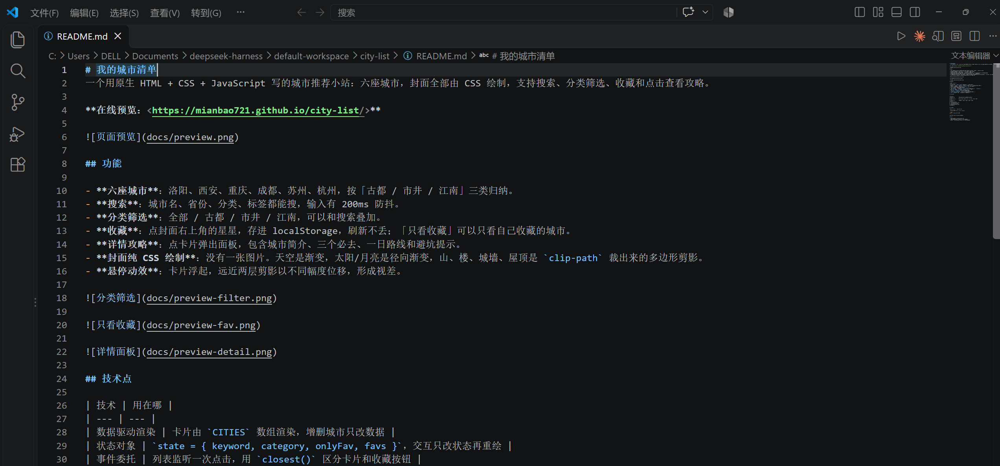
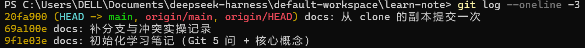

# Git 学习笔记：从本地仓库到团队协作

> 一句话：Git 是装在本地的版本控制工具，GitHub 是把它托管到网上、再加协作功能的平台。所有 Git 操作，本质上都是在几个分区之间搬文件。

---

## 一、先记住这张图：四个区域

```
工作区 --git add--> 暂存区 --git commit--> 本地仓库 --git push--> 远端仓库
  ↑                                              │
  └────────────── git pull（= fetch + merge）─────┘
```

- **工作区**：你在文件夹里能直接改的那些文件。
- **暂存区**（staging / index）：commit 前的"购物车"，先挑这次要提交哪些改动。
- **本地仓库**：`.git` 里存的所有历史，快照一条条串起来。
- **远端仓库**：GitHub / Gitee 上那份，推上去别人才看得到。

VS Code 里"Commit"一个按钮其实做了 `add + commit` 两步；想只提交部分文件，就先把文件点 `+` 放进暂存区。

两个方向也要记牢：

- `git clone`：一步同时生成"本地仓库 + 工作区"，拿到的是**整个历史**
- `git pull` = `git fetch`（只下载）+ `git merge`（合并进当前分支）

## 二、五个核心概念

### 2.1 仓库

被 Git 管的文件夹。灵魂是里面的 `.git` 目录，删了它，文件夹就变回普通文件夹——历史全在那里面。

### 2.2 提交（commit）

一次快照 + 一条说明 + 一个哈希值。

关键在于**快照，不是差异**：每次提交是把当时所有文件的状态拍一张照片，不是只记"第 3 行改了"。所以回退很直接——把那张照片拿出来就行。

哈希就是 commit id，长 ID 和短 ID（前 7 位）等价，仓库内唯一。跟 AI 或队友描述"第几次提交"很容易错，**直接给 commit id 最准**。

还有一点容易误解：**回退不是改历史**，而是把旧的那次提交检出来看，或者在它上面再提交一次。

### 2.3 分支（branch）

指向某次提交的**指针**，不是复制代码。

默认主干叫 `main`（老仓库可能叫 `master`）。新建分支只是多插一个路标，不复制文件，所以几乎不花成本；切换分支就是把 HEAD 挪过去，工作区的文件跟着变。

在 feature 分支上提交的东西，切回 main 就看不见——两条线互不影响。

### 2.4 HEAD 和 detached HEAD

**HEAD** 表示"当前在哪次提交上"。正常情况它跟着分支走。

如果 HEAD 直接指向某次历史提交、不在任何分支上，就是 **detached HEAD**——这时**只适合看代码，改东西容易丢**。

想回到历史有两条路：`checkout` 到某次提交（只看不改），或者**基于那次提交新建一个分支**（可以放心改，有分支管着）。

### 2.5 合并（merge）

把分支的改动合回主干，分三种情况：

- **快进**：主干没动过，指针直接往前挪，不产生新提交
- **三方合并**：两边都有新提交，生成一次合并提交把两条线接上
- **冲突**：两边改了同一处，Git 判断不了，交给人决定

合完一般把分支删掉（当前所在的分支不能删，得先切走）。

## 三、撤销与回退：三种"后悔药"

| 操作 | 干了什么 | 什么时候用 | 风险 |
|---|---|---|---|
| **discard** | 丢掉还没 commit 的改动 | 改乱了、想重来 | 低，只丢未提交内容 |
| **revert** | 生成一次"反向提交"抵消某次 commit | **多人分支上回退** | 低，不改历史 |
| **reset --hard** | 指针直接退回某次提交，后面的提交全丢 | 只有自己的分支、还没推 | 高，推过就得 force push，**多人分支禁用** |

记法：**没提交用 discard；多人用 revert；单人没推用 reset。**

## 四、远端与协作

### 4.1 四个命令的方向

| 命令 | 方向 | 说明 |
|---|---|---|
| `git clone <url>` | 远端 → 本地 | 建好本地仓库和工作区，拿到整个历史 |
| `git push` | 本地 → 远端 | 只有仓库成员或协作者能推，别人的仓库推不上去 |
| `git fetch` | 远端 → 本地 | 只下载新提交，不动你的代码 |
| `git pull` | 远端 → 本地 | = fetch + merge |

`origin` 是远端仓库的默认别名；`origin/main` 是远端主干在你本地的"追踪指针"，`main` 是你自己的分支。本地领先远端时会显示 `Sync Changes 2 ↑`，点一下就同步。

动手写代码前先 `pull`，是团队里最省事的习惯。

### 4.2 GitHub 网站看这几块

- **Code**：源码，可下载 zip；每个文件后面显示最近一次提交，全是几年前说明项目停更了
- **README**：自动展示在下面，讲项目是什么、怎么跑
- **Releases**：发布版本和打包好的程序
- **About**：简介、标签、Star 数、开源协议
- **Fork**：复制一份到自己名下（地址里的用户名会变成你）
- **Issues**：提 bug、问问题；**用别人项目之前先搜 Issues**，很多坑有人踩过

快捷键：`/` 搜全站，`t` 按文件名搜，`l` 跳行，`?` 看速查表，`.` 打开网页版 VS Code。

### 4.3 两种协作方式

**给开源项目贡献（Fork 模式）**

1. Fork 上游项目到自己账号下
2. clone 自己那份到本地
3. **先开 feature 分支**，别在 main 上改
4. 改 → commit → push 到自己的仓库
5. 把上游最新代码同步进这个分支，本地解掉冲突
6. 发 PR，方向是：**自己的 feature → 母项目的 main**
7. 对方 review 通过后 merge，你的名字进 Contributors

**团队内部（Collaborator 模式）**

管理员在 Settings → Collaborators 加人，对方在收件箱接受。有推送权限，可以跳过 fork：开分支 → 改 → push → 同步主干 → PR → 审核合并。

> PR 直译"拉取请求"，实际就是**合并请求**：把一个分支的改动合进另一个分支的提案。

## 五、任务书 5 个问题，我的回答

**1. Git 是什么？为什么它能被广泛使用？**

分布式的版本控制软件。每次提交给整个项目拍快照，用哈希把快照串成历史。它流行的原因不是"操作简单"（命令是有门槛的），而是：分布式（每台电脑都有完整历史，断网能用）、分支便宜、本地操作快、平台生态成熟。

**2. 为什么需要版本控制？复制备份有什么局限？**

最直接是敢改，改坏了能退。更值钱的是**能查**（谁、何时、改了哪行、为什么）和**能一起改**（各开分支再合并）。复制备份只解决"文件还在不在"：不知道改了什么、为什么；两人同时改只能人工覆盖；没法分头试验；命名靠人脑，过一周就认不出。

**3. Git、GitHub 和 Gitee 分别是什么？有什么区别？**

- **Git**：装在自己电脑上的版本控制工具，不用网络、不用账号，`git init` 一下就有仓库
- **GitHub**：国外的代码托管平台，把仓库放到云上，再叠加 PR、Issue 这些协作功能，开源项目最多
- **Gitee**：国内的同类平台，中文界面、访问快，国内团队和学校项目用得多

区别：Git 是**工具**，另外两个是**平台**——没有平台 Git 照样用，没有 Git 平台没内容可托管。两个平台之间主要差在访问速度和生态。

我原本以为 Git 只能保存在本地，其实它只是不依赖服务器也能工作，加个远程地址就能 push 上去，`clone` 下来还是整个历史。

**4. 什么是仓库、提交、分支和合并？**

见第二节，一条链记：**仓库装历史，提交是快照，分支是指针，合并是接线。**

**5. 团队协作中怎么用 Git 管理和同步项目文件？**

一圈走下来：先 `pull` 拿最新 → 开自己的分支改 → 小步提交，信息写清做了什么、为什么 → `push` → 发 PR → 队友 review 过了再合 → 合完删分支，本地再 `pull` 一次。核心是**各在各的分支上改，靠 PR 汇总到 main**。

新手最常见的误解是"直接改 main 最快"，其实走一步 PR，反而省掉后面一堆麻烦。

（补充）两边改到同一处就会冲突：改文件里 `<<<<<<<` 和 `>>>>>>>` 之间那段，留下想要的，再 `add` + `commit` 就完事。

## 六、实操记录

### 6.1 开分支、改、合并

在 city-list 上开 `feature/test`，改 README 标题，切回 main 再 merge。这次是**快进合并**：main 没有新提交，指针直接挪过去，不会产生新的合并提交。


### 6.2 制造并解决一次冲突

再开 `feature/conflict` 和 main 各改同一行标题，merge 时直接报 `CONFLICT`。

我原以为 Git 会自动挑一个留下，实际是把两边的内容都写进文件，用 `<<<<<<<`、`=======`、`>>>>>>>` 标出来让我决定——它不猜，只负责把矛盾摆到脸上。


解决方式：删掉三行标记，只留一行标题，保存后 `git add` + `git commit`。



### 6.3 克隆仓库、拉取更新

把仓库克隆到旁边一个新文件夹，在副本里改 README 底部加一行，提交并推上去；再回到原目录 `git pull`，那行就同步回来了。

```powershell
git clone https://github.com/mianbao721/learn-note.git learn-note-clone
# 改 README 末尾一行
git commit -am "docs: 从 clone 的副本提交一次"
git push
cd ..\learn-note
git pull          # 输出 Fast-forward
```

拉完 `git log --oneline -3` 第一条是：

```
20fa900 (HEAD -> main, origin/main, origin/HEAD) docs: 从 clone 的副本提交一次
```



三个标签挤在一行，说明本地 main、远端 main、远端默认分支都指向同一次提交——完全同步。以前不懂 `origin/main` 是啥，现在明白它就是"远端 main 在本地的影子"，`pull` 完两个指针重合，所以并列显示。

## 七、常用命令

```bash
# 本地
git init / git status / git add . / git commit -m "说明"
git log --oneline --graph --all

# 分支
git switch -c feature/xxx      # 新建并切换
git switch main                # 切回来
git merge feature/xxx          # 合并
git branch -d feature/xxx      # 删除已合并的分支

# 远端
git clone <url> / git remote add origin <url>
git push -u origin main        # 第一次带 -u，之后 git push 即可
git pull

# 撤销
git restore <file>             # 丢掉工作区改动
git revert <commit>            # 反向提交，安全
git reset --hard <commit>      # 强制回退，危险
```

## 八、几组容易混的 + 几个坑

| 对比 | 区别 |
|---|---|
| commit / push | 一个存本地，一个传远端 |
| clone / fork | clone 下载到自己电脑，fork 复制到自己账号 |
| fetch / pull | 只下载 / 下载并合并 |
| merge / rebase | 保留两条线 / 拉成一条线（要强推） |
| reset / revert / discard | 删历史 / 加反向提交 / 丢未提交 |
| HEAD / 分支 | 你现在在哪 / 一根可移动的指针 |

坑：

1. `.gitignore` 一开始就建，`.env`、`node_modules/` 别推上去（目录末尾要加 `/`）
2. 别人的仓库不能直接 push，只能 fork + PR，或先被加为协作者
3. 多人分支别用 `reset --hard` 和 `push -f`，会盖掉别人的提交
4. detached HEAD 状态下别改代码
5. 小步提交，信息写清"做了什么、为什么"

## 九、下一步

- 完整走一次 fork → 分支 → PR：找一个练手仓库，或用自己的小号当上游
- 在 personal 分支上试一次 rebase + 强推，体会"历史被重排"是什么感觉
- 把 `git log --graph` 养成习惯：每做完一个功能看一眼，比背命令有用
