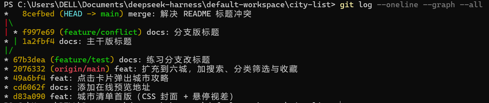
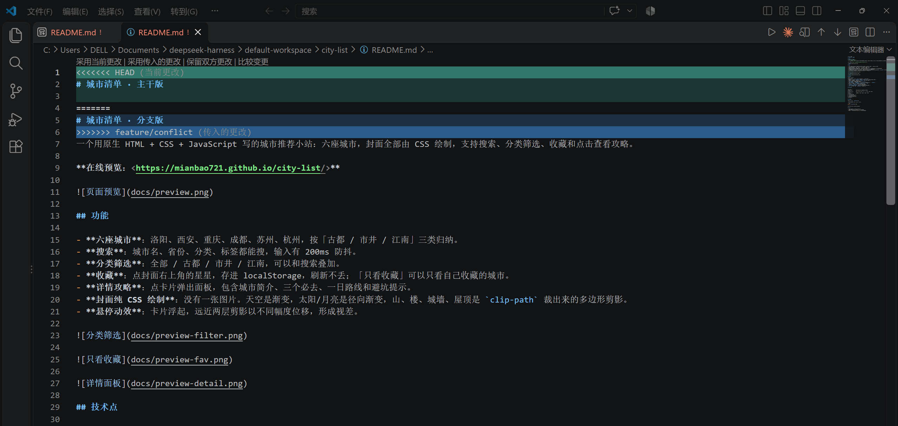

# Git 学习目标（5 问）

## 1. Git 是什么？为什么它能够成为广泛使用的版本控制工具？

Git 是分布式的版本控制软件，能记住项目每次改动，随时回到某一次提交。它存的是**整个项目的快照**——每次提交相当于给所有文件拍一张照片，不是只记一笔"第 3 行改了"，想回哪一版把那张照片拿出来就行。每个提交还带个哈希值（像身份证号），内容一动号就变，历史很难被偷偷改掉。

我原以为它流行是因为免费、简单、能连 GitHub，其实不是：命令本身有门槛，GitHub 也只是托管平台。真正的原因是分布式——每台电脑都有完整历史，断网能提交，服务器挂了代码也还在；加上分支几乎不花成本。

## 2. 为什么开发者需要版本控制？直接复制文件备份有什么局限？

最直接的好处是敢改，改坏了能退回去。但更值钱的是**能查**（谁、什么时候、改了哪行、为什么）和**能一起改**（各开分支，做完再合）。

复制备份只解决"文件还在不在"：不知道每次改了什么、为什么改；两个人同时改只能人工覆盖；想分头试两种方案，只能复制整个文件夹；命名靠人脑，过一周自己都认不出。

## 3. Git、GitHub 和 Gitee 分别是什么？它们之间有什么区别？

- **Git**：装在自己电脑上的版本控制工具，不用网络、不用账号，`git init` 一下就有仓库。
- **GitHub**：国外的代码托管平台（微软旗下），把 Git 仓库放到云上，再提供 PR、Issue 这些协作功能，开源项目最多。
- **Gitee**：国内的同类平台，中文界面、访问快，国内团队和学校项目用得多。

区别一句话：Git 是**工具**，上面两个是**平台**——没有平台 Git 照样用，没有 Git 平台就没东西可托管。两个平台之间，主要差在访问速度和生态：GitHub 项目多、资料全，Gitee 国内打开快。

我原本以为 Git 只能保存在本地，其实它只是不依赖服务器也能工作，加个远程地址就能 push 上去，`clone` 下来还是整个历史。

## 4. 什么是仓库、提交、分支和合并？

先看四个区域：工作区 →（add）→ 暂存区 →（commit）→ 本地仓库 ⇄（push / pull）⇄ 远程仓库。

- **仓库**：被 Git 管的文件夹，历史都在 `.git` 里，删了 `.git` 就变回普通文件夹。
- **提交**：给所有文件拍一张快照，带作者、时间、说明和哈希，一个接一个串起来就是历史；回退不是改历史，是把旧的那次检出来看。
- **分支**：指向某次提交的指针，新建时只是多插一个路标、不复制文件，所以几乎不花钱。
- **合并**：把两条线接起来——没分叉就快进；两边都改了，生成合并提交；改到同一处就冲突，人来定。

## 5. 在团队协作中，如何使用 Git 管理和同步项目文件？

一圈走下来是：先 pull 拿最新（pull 其实是 fetch + merge）→ 开自己的分支改 → 小步提交，信息写清做了什么、为什么 → push → 发 PR → 队友 review 过了再合 → 合完删分支，本地再 pull 一次。核心是**各在各的分支上改，靠 PR 汇总到 main**，这样谁也不会把别人的代码盖掉。

新手最常见的误解是"直接改 main 最快"，其实走一步 PR，反而省掉后面一堆麻烦。

（补充）如果两边改到同一处，合并时会冲突：改文件里 `<<<<<<<` 和 `>>>>>>>` 之间那段，留下想要的，再 add + commit 就完事。

---

## 实操记录

### 1. 开分支、改、合并

在 city-list 上开 `feature/test`，改 README 标题，切回 main 再 merge。这次是**快进合并**：main 没有新提交，指针直接挪过去，不会产生新的合并提交。



### 2. 制造并解决一次冲突

再开 `feature/conflict` 和 main 各改同一行标题，merge 时直接报 `CONFLICT`。

我原以为 Git 会自动挑一个留下，实际是把两边的内容都写进文件，用 `<<<<<<<`、`=======`、`>>>>>>>` 标出来让我决定——它不猜，只负责把矛盾摆到脸上。



解决方式：删掉三行标记，只留一行标题（我最后留的是 `# 我的城市清单`），保存后 `git add` + `git commit`。


最后 `git log --oneline --graph --all` 能看到两条线汇到一个 merge 提交，那一刻才真的看懂"分支只是指针、合并是接线"。

### 3. 克隆仓库、拉取更新

把仓库克隆到旁边一个新文件夹，在副本里改 README 底部加一行，提交并推上去；再回到原目录 `git pull`，那行就同步回来了。

```powershell
git clone https://github.com/mianbao721/learn-note.git learn-note-clone
# 改 README 末尾一行
git commit -am "docs: 从 clone 的副本提交一次"
git push
cd ..\learn-note
git pull          # 输出 Fast-forward
```

拉完 `git log --oneline -3` 第一条是：

```
20fa900 (HEAD -> main, origin/main, origin/HEAD) docs: 从 clone 的副本提交一次
```


三个标签挤在一行，说明本地 main、远端 main、远端默认分支都指向同一次提交——完全同步。以前不懂 `origin/main` 是啥，现在明白它就是"远端 main 在本地的影子"，`pull` 完两个指针重合，所以并列显示。
